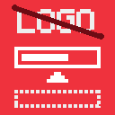
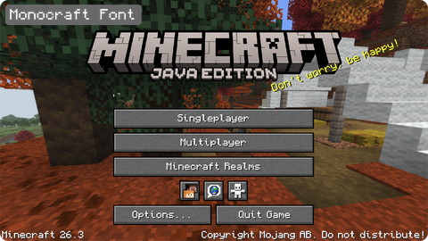

# Minecraft Projects

Minecraft mods and resource packs by [EnderNoch](https://github.com/EnderNoch), for Minecraft
Java Edition 26.3. Each one does one small thing, stays close to vanilla and is tested in the
game before it goes out.

*[Po polsku niżej.](#po-polsku)*

| | Project | What it does | |
| :---: | --- | --- | :---: |
|  | **[Centered Loading Bar](https://github.com/EnderNoch/Centered-Loading-Bar)** Fabric mod | Hides the Mojang Studios logo on loading screens and moves the loading bar to the middle of the screen. Client-side, needs only Fabric Loader. [Modrinth](https://modrinth.com/mod/clb) |  |
|  | **[Monocraft Font](https://github.com/EnderNoch/Monocraft-Font)** Resource pack | Draws all of the game's text in Monocraft, a Minecraft-style monospaced font, pixel-exact on the vanilla grid. [Modrinth](https://modrinth.com/resourcepack/monocraft-font) |  |

## Installing

Each project is on Modrinth: in the Modrinth App or Prism Launcher, search for its name and click
**Install**, or download the file from its Modrinth page. Mods need a profile with
[Fabric Loader](https://fabricmc.net/use/) and go into the `mods` folder; resource packs go,
still zipped, into the `resourcepacks` folder and are turned on in **Options → Resource Packs**.

## License

Each project has its own license, see its repository.

Not official Minecraft products. Not approved by or associated with Mojang or Microsoft.

---

## Po polsku

Mody i paczki zasobów do Minecraft Java Edition 26.3 od EnderNoch. Każdy robi jedną małą rzecz,
trzyma się wyglądu vanilli i jest sprawdzony w grze, zanim trafi do sieci.

- **[Centered Loading Bar](https://github.com/EnderNoch/Centered-Loading-Bar)** (mod Fabric) —
  chowa logo Mojang Studios na ekranach ładowania i przesuwa pasek ładowania na środek ekranu.
  Działa tylko po stronie klienta, potrzebuje samego Fabric Loadera.
  [Modrinth](https://modrinth.com/mod/clb)
- **[Monocraft Font](https://github.com/EnderNoch/Monocraft-Font)** (paczka zasobów) — cały tekst
  w grze rysowany czcionką Monocraft w stylu Minecrafta, co do piksela na siatce vanilli.
  [Modrinth](https://modrinth.com/resourcepack/monocraft-font)

Instalacja: każdy projekt jest na Modrinth — w Modrinth App albo Prism Launcherze wyszukaj nazwę
i kliknij **Install** albo pobierz plik ze strony projektu. Mody wymagają profilu z
[Fabric Loaderem](https://fabricmc.net/use/) i trafiają do folderu `mods`; paczki zasobów, bez
rozpakowywania, do folderu `resourcepacks`, a włącza się je w **Opcje → Paczki zasobów**.

Licencja: każdy projekt ma własną, opisaną w jego repozytorium.
